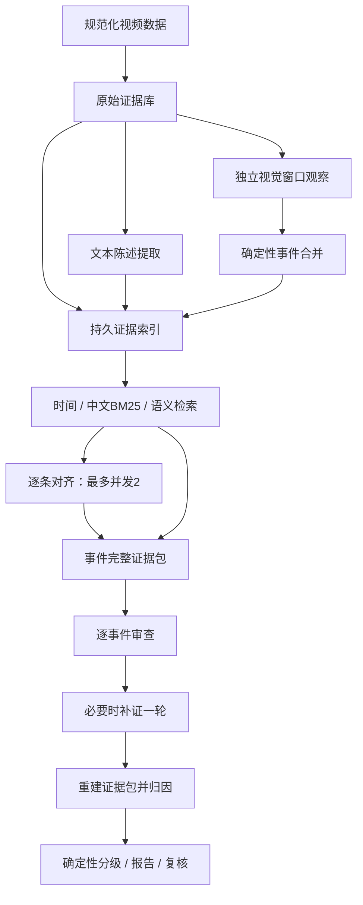

# 当前证据 RAG 架构

实现版本：`rag-v1`。确定性 Python 协调器管理五个角色，不增加自由规划或联网检索角色。

## 模块接口

- `retrieval.py`：`EvidenceIndex` 保存视频/源版本/向量模型/派生版本隔离的原子快照；
  `Retriever.retrieve` 返回候选及 `RetrievalTrace`，不判断证据是否支持结论。
- `evidence_pack.py`：`build_evidence_pack` 返回 `EvidencePack`，完整必需内容优先，
  尾部补充候选可移除。包不完整时模型调用被拒绝，进入人工复核。
- `rag_runtime.py`：构建原始/派生索引、组装逐条输入、独立检查点和有限并发。
  索引注册全部原始记录，已有 span 的重复 OCR 原记录保留可追溯入口，不独立重复排名。
- `pipeline.py`：协调器拥有任务状态和产物写入；worker 仅执行单条模型判断。
  五角色顺序不变，仅对齐请求并发，归因之前完成审查和有限补证。
- `llm/scheduling.py`：同端点共享并发槽、节流与429冷却；独立embedding端点使用独立限流域。
  两个端点共享运行调用预算。Token预算沿用完成后记账的软上限，不作为严格金额上限。

## 证据与失效约束

首轮视觉不接收标题、字幕陈述或评论引导。时间陈述仅关联重叠/邻近2秒事件；
无时间陈述按语义top-5和词面top-5并集精判。原始帧通过观察文本检索，再回指画面，
没有引入图像向量模型。相似度只用于候选与复述提示，不能证明同源、真实性或缺陷根因。

模型只能引用本次请求提供的ID；已存在但未提供的ID同样拒收。检索补充材料标为待判断，
不直接加入supports。完整包进入真实messages，不能只保存在mock使用的context字段。

缓存和索引隔离端点、模型、维度和文本预处理版本；零向量、非有限数、维度不符均不能
产生伪top-k。预算/鉴权异常保留停止语义，其余向量失败记录原因并回退全候选。
逐条检查点指纹覆盖源输入、候选上下文、提示词及模型参数；更改输入不会复用旧判断。

## 恢复与验证

旧manifest无版本时恢复legacy；新运行记录版本、配置、usage口径和模型信息。
补证每事件最多一轮，媒体请求每次不超过8帧。补帧及观察ID包含事件标识，成功补证恢复时
从落盘产物重建原始记录和观察，不重复付费调用。中断后最多两个在途对齐结果会保存。

实现的工程测试覆盖引用、隔离、恢复、并发和上下文溢出。真实效果验收还需人工完成
v2/v4/v7/v10检索基准；未标注项不能当作召回为零或正确，mock结果不能当作语义效果。
实验步骤与产物见 `RAG_BENCHMARK.md`。
