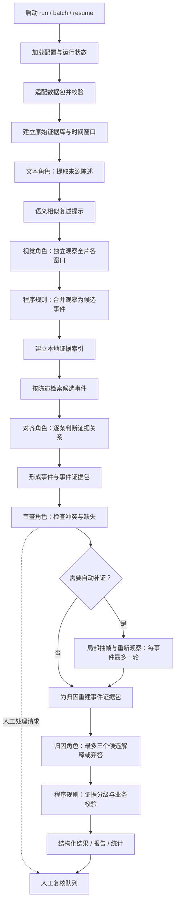

# 当前 Agent 详细工作流程

整理日期：2026-09-27  
对象：`driving_defect_agent` 智能驾驶缺陷线索提取与归因研究原型  
基准：当前源码与 `config/default.yaml`，重点说明新运行默认采用的 `rag-v1`。

本文描述项目 Agent 的实际处理流程。具体运行可能使用自定义配置、环境变量或历史配置快照，因此参数应以该次运行的 `run_manifest.json` 和 `config_snapshot.json` 为准。本文通过代码核对整理，未重新执行真实 API 分析或效果评测。

## 1. 整体目标与组织方式

Agent 读取已经整理好的视频数据包，将标题、简介、ASR、OCR、评论与视频帧组织成证据，提取异常现象线索，建立陈述与事件的关系，再进行审查、有限补证和候选归因，最终输出结构化文件、分析报告及人工复核清单。

整个系统由 **Python 确定性协调器 + 五个模型角色 + 本地证据检索 + 规则校验** 组成。协调器控制处理顺序、任务状态、预算和落盘；模型负责局部语义判断。五个角色可以使用相同或不同的已配置模型，并不意味着五个独立模型同时运行。

系统始终区分三层内容：

| 层次 | 回答的问题 | 示例 |
|---|---|---|
| 可观察现象 | 画面中能看到什么？ | 车辆接近车道线、出现横向移动 |
| 来源陈述 | 发布者、字幕或评论说了什么？ | 评论声称“当时开启了辅助驾驶” |
| 候选归因 | 哪些解释值得进一步验证？ | 道路变化、驾驶员操作或系统能力问题 |

来源陈述与候选归因不能直接当作已证实事实。最终假设的 `verification_status` 固定为 `unverified`，所有事件保留人工复核要求。

## 2. 总体流程图



图中表示单个视频的实际阶段顺序。文本提取虽然先执行，但首轮视觉请求不接收其结论。当前批量处理按视频依次进行，仅 `rag-v1` 的逐条对齐请求采用有限并发。

## 3. 五个模型角色的职责

| 角色 | 主要输入 | 主要输出 | 职责边界 |
|---|---|---|---|
| 文本提取 `text_extract` | 标题、简介、ASR、OCR spans、评论及必要父评论上下文 | `Claim` 来源陈述 | 提取“谁说了什么”，保留引用和时间范围 |
| 视觉观察 `visual_observe` | 采样帧、帧 ID、时间戳、窗口范围 | `VisualObservation` 画面观察 | 描述可见现象、系统状态线索及观察限制 |
| 证据对齐 `align` | 单条陈述、候选事件摘要、该陈述的原始来源材料 | 陈述—事件关系 | 区分支持、反对、可能相关和无关 |
| 审查 `review` | 单事件的完整证据包 | 问题、信息缺口、补证请求 | 主动寻找反证、替代解释和证据不足 |
| 候选归因 `attribution` | 包含补证结果的事件证据包 | 最多 3 个假设及反事实验证要求，或空假设 | 提出待验证解释，不确认根因 |

提示词保存在 `prompts/`。审查角色使用 `critic.md`；模型输出先通过结构与引用校验，再进入后续阶段。

## 4. 分阶段详细流程

### 4.1 启动、配置与运行建档

1. 通过 `run` 处理一个数据包，或通过 `batch` 扫描数据根目录；`resume` 用于恢复已有运行。
2. 加载 YAML 参数，以及环境变量或 `.env` 中的模型与端点配置；环境变量优先于 `.env`。
3. 确定运行模式：命令默认是 `mock`，显式指定 `--mode live` 才执行真实模型调用。
4. 建立运行目录、SQLite 状态库、调用记录和错误日志，保存配置快照、提示词哈希、模型信息及流水线版本。
5. 初始化模型客户端、响应缓存、预算跟踪器和可用的 embedding 客户端。

`doctor`、`inspect` 和 `normalize` 可用于单独检查环境与输入；完整运行本身也会执行数据加载、归一化与校验。

### 4.2 数据适配与校验

输入以 `agent_input.json` 为入口，适配器将不同数据包结构转换为统一的 `NormalizedPackage`。当前支持 schema `1.0.0` 的 V1 结构和 schema `1.0` 的 V2 结构；数据目录名称如 `v2`、`v10` 与适配器版本不是同一概念。

统一材料主要包括：

| 材料 | 在流程中的用途 |
|---|---|
| 标题、简介 | 提供视频级背景与来源陈述 |
| ASR | 提供带时间区间的语音转写材料 |
| OCR 与 OCR spans | 提供画面文字及其连续观测记录 |
| 评论与回复关系 | 提供视频级陈述和对话上下文 |
| 全画面帧与时间戳 | 首轮视觉分析输入 |
| 视频片段及其时间范围 | 必要时抽取补证帧 |

程序检查路径、文件、引用、时间范围和数据一致性。关键校验失败的视频标记为 `failed`；可容忍问题保留警告，例如数据包缺少某条评论的父评论。原始数据包只读，派生结果写入项目目录。

这里消费的是已准备好的 ASR、OCR 和评论数据；主流程不负责重新抓取社交平台内容或重新完成全片语音识别。

### 4.3 建立证据库与切分窗口

每条原始材料转换为 `EvidenceRecord`，使用全局证据 ID：

```text
{video_id}::{kind}::{local_id}
```

证据记录保留原文、时间、来源文件、媒体路径、质量标记、来源分组及底层引用。OCR span 与其底层 OCR 记录共享来源分组，避免把同一段文字的重复观测误当成多份独立证据。

默认窗口为 **6 秒核心区间 + 前后各 1 秒上下文**。首尾按视频边界裁切，末尾不足 6 秒的片段仍保留。时间文本按区间相交纳入窗口；同一条记录可能出现在相邻窗口，后续会处理重复陈述。

首轮视觉从已有帧索引中，按约 **1 Hz** 的目标采样点选取全画面帧，每个请求最多 **8 张**。字幕裁剪图不作为道路画面输入。图像经派生处理后发送，默认长边不超过 **1280 像素**，JPEG 质量为 **85**。

### 4.4 文本角色提取来源陈述

文本分为三类批次：

1. **背景批次**：标题与简介。
2. **时间文本批次**：各窗口内的 ASR 与 OCR spans；默认 `per_window`，也提供合并窗口文本的 `merged` 配置。
3. **评论批次**：按评论记录边界拆分，必要时附上父评论作为理解上下文。

普通文本默认每批最多 80 条、目标字符阈值 8000；评论默认每批最多 30 条、目标字符阈值 6000。拆批保留完整记录，单条超长记录仍可能超过字符阈值。

模型提取现象、系统状态、场景、原因、车辆身份等类型的陈述。程序检查引用是否属于本批材料，并约束时间信息；无可靠视频内时间的标题或评论保持视频级范围，不能编造事件时间。

跨窗口重复陈述按陈述类型、文本片段和引用集合去重，然后分配 `Claim` ID。非法草稿记录为拒收项。文本输出发生截断时，协调器可按记录边界拆成两半重试一次。

随后可执行陈述语义相似度检测，默认阈值为 **0.90**。在 `rag-v1` 中，相似结果只记录为 `possible_match` 提示，不删除陈述，也不据此确认同源。

### 4.5 视觉角色独立观察

协调器依次发送各窗口的采样图像、帧 ID、时间戳和窗口范围。首轮视觉请求不接收标题、评论或文本角色推断，减少既有叙述对观察的影响。

每条 `VisualObservation` 包含现象描述、现象类型、引用帧、时间区间、可见性、连续性、系统状态线索和局限说明。可识别的类型包括越过车道边界、异常横向移动、表观减速、接近障碍物、碰撞接触、驾驶员介入、系统状态变化，也允许 `none_observed` 和 `uncertain`。

首轮覆盖全片的各个时间窗口，但属于稀疏图片观察，不能保证捕获每个瞬时动作。模型并非直接观看完整连续视频。

### 4.6 程序生成候选事件

事件合并由 `merge_observations` 的确定性规则完成：

1. 排除 `none_observed`，保留包括 `uncertain` 在内的其他观察。
2. 按起止时间排序。
3. 现象类型相同、相邻观察间隔不超过 **1 秒**，且连续性描述没有剪辑、回放等疑点时，合并到同一簇。
4. 不能合并则形成新簇；相邻同类簇在 **3 秒**内可标记为 `possibly_related`，但仍保留为独立事件。

事件时间取簇内观察的起止范围，初始 `boundary_status` 为 `coarse`。聚合摘要目前对每条观察取前 80 字，再拼接为最多 400 字；完整观察仍单独保留。

**当前事件来自视觉观察簇。文本陈述和评论参与关联、支持或反驳，不独立生成事件。** 因此，关闭视觉阶段时不能把“提取到文本陈述”理解为“已经得到事件级视觉验证”。

### 4.7 RAG 检索与逐条对齐

`rag-v1` 在 `work/evidence_index.sqlite` 中维护本地证据索引，包含原始记录和派生文本，并按视频、来源版本和模型等信息隔离。这里的 RAG 检索已导入的证据，不增加联网搜索角色，也不使用图像 embedding。

对每条陈述生成候选事件：

| 陈述类型 | 候选获取方式 |
|---|---|
| 有时间范围 | 保留时间重叠或邻近 2 秒的事件 |
| 无视频内时间 | 取语义检索 top-5 与 BM25 词面检索 top-5 的并集，去重后精判 |
| 向量不可用或异常 | 记录原因，视频级检索退回全候选；预算或鉴权异常按停止规则处理 |

语义 top-5 与词面 top-5 的并集可能超过 5 个候选。检索相似度只决定送哪些候选给模型，不直接决定支持关系。

对齐角色每次接收 **一条完整陈述、候选事件摘要，以及该陈述原始来源和可用父评论上下文**。当前不是把每个候选事件的完整原始证据都发送给对齐角色；完整事件证据包用于下一阶段的审查与归因。

模型逐对判断 `supports`、`contradicts`、`possible_match`、`unrelated` 等关系。程序校验返回的陈述与事件 ID，只接受本次请求提供的候选范围，再更新事件关联的陈述、支持证据和冲突证据。

该阶段固定逐条请求，默认最多并发 **2 条**，每条有独立检查点和输入指纹。RAG 减少的是候选对和上下文规模，不等于按相同比例减少模型请求数。

### 4.8 组装完整事件证据包

审查和归因按事件构建 `EvidencePack`，主要包含：

- 事件信息、完整画面观察、关联陈述及其限制说明。
- 已关联的支持与反对材料，以及原始文本、时间和来源。
- OCR span 的底层溯源记录与可用的父评论上下文。
- 通过时间、语义、词面检索得到的补充候选材料。
- 本次允许引用的原始证据 ID，即 `allowed_evidence_ids`。

补充候选和父评论明确标记为上下文，不能自动计入支持证据。帧记录在包中提供来源与引用；审查、归因请求不会因此重新查看原图。

当前主流程对陈述来源包、审查和归因事件包，以及对齐拼接提示文本，**不设程序字符上限**；模型服务自身的上下文容量仍然有限。重复 OCR 溯源元数据可采用无损紧凑表表示，保留引用和可还原的信息。

缺少必需证据、观察、陈述，或混入其他视频材料时，证据包标记不完整，阻止将其当作完整上下文正常调用；事件最终进入 `incomplete_context`，视频保留 `partial` 和复核项。源数据原本缺少父评论则标记信息缺口，不伪造父评论。

### 4.9 审查与有限补证

审查角色逐事件寻找冲突、缺失信息和合理替代解释，输出问题列表及补证请求。问题进入人工复核队列。

| 补证请求 | 当前执行方式 |
|---|---|
| `request_more_frames` | 自动局部抽帧并重新观察 |
| `request_original_resolution` | 自动局部抽帧并重新观察；当前与上一项共用原分辨率补帧路径 |
| `request_human_audio_review` | 转人工复听音频 |
| `request_human_system_state_review` | 转人工核验系统状态 |
| `request_source_identity_review` | 转人工核验来源身份 |

自动补证每事件最多一轮：使用 FFmpeg 从已有视频片段抽取事件附近最多 **6 秒**的画面，默认 **4 Hz**、总计最多 **24 张**，按每请求最多 **8 张**拆分给视觉角色。

补证成功后，新增帧和观察加入证据库及事件，重新注册检索记录，再为归因构建包含补证结果的证据包。补证 ID 包含事件标识，以避免不同事件相互覆盖；恢复时可以从检查点重建帧记录与观察。

当前是一次审查加有限补证，没有自动反复审查循环，也不在补证后重新执行全局事件合并和陈述对齐。`boundary_status=refined` 表示进行了补证，现有路径并不据此自动改写事件的起止时间。

### 4.10 候选归因与反事实说明

归因角色读取更新后的事件证据包，最多提出 3 个与该事件有关的解释。每个假设需列出支持证据、反对证据、替代解释、缺失信息，以及结构化反事实：改变什么条件、保持什么条件、预期出现什么差异、可能的混淆因素和所需验证材料。

允许的解释方向包括道路或交通环境、合理驾驶行为、驾驶员操作或系统使用状态、视频剪辑与信息缺失，以及尚待验证的系统能力问题。证据不足时可返回空 `hypotheses` 并说明原因。

程序检查假设引用是否属于本次证据包，之后分配假设 ID。反事实是验证思路，不是已经执行的仿真实验；所有假设仍为 `unverified`。

### 4.11 规则分级、业务校验与报告

最终分级由程序规则完成，分别评估三个维度：

| 维度 | 当前规则概要 |
|---|---|
| 现象证据 | 根据有效观察、可见性、连续性相关条件和冲突情况评为 high / medium / low / insufficient |
| 系统状态证据 | 有画面状态描述通常为 medium；只有来源声称为 low；缺少材料为 insufficient；不自动授予 high |
| 归因证据 | 有假设且支持引用包含帧证据时可为 medium；其他假设通常为 low；无假设为 insufficient；不自动授予 high |

系统参与状态采用保守规则：当前自动流程主要输出 `reported_active` 或 `unknown`，不自动授予 `observed_active`。这些等级是工程规则标签，不是真实性概率。

事件最终判定包括 `suspected`、`insufficient_evidence`、`not_supported` 和 `not_applicable`。其中 `suspected` 需要非 `uncertain` 的现象、足够现象证据、系统参与线索及规则允许的冲突状态；它仍表示待复核线索。业务校验或上下文完整性检查未通过时降为证据不足。

报告由模板渲染已通过处理的结构化内容，不在报告阶段重新调用模型扩写事实。每个事件都会追加人工复核项。

## 5. 贯穿全程的运行控制

### 5.1 输出校验与格式修复

模型输出依次经过 JSON 解析、Pydantic schema 校验、引用与时间约束检查，以及最终业务规则检查。结构合法不代表结论正确。

格式不合格时，将最新输出、具体错误和完整 schema 发回模型修复。当前默认首次失败后最多追加 **3 轮**格式修复；`--max-format-repairs 0` 可关闭。网络重试与格式修复分别计数，真实请求均纳入调用与 token 统计。

超过修复次数、请求时限或预算后，任务保留失败或暂停状态，不能把未通过校验的输出标记为成功。材料中的指令、评论或字幕只作为数据，不改变角色任务。

### 5.2 缓存、检查点与恢复

任务状态包括 `pending`、`running`、`succeeded`、`failed`、`skipped` 和 `paused_budget`；视频状态包括 `complete`、`partial` 和 `failed`。

成功任务输出落盘后再标记完成。恢复时将残留的 `running` 转回待处理，对符合检查点条件的成功任务直接读取结果；失败或未完成任务继续处理。`rag-v1` 的关键任务还校验输入指纹，覆盖来源材料、候选上下文、提示词和模型参数，避免错误复用旧判断。

`resume` 保留原 manifest、配置快照和流水线版本；历史运行没有版本信息时按 `legacy` 恢复，不自动升级为 `rag-v1`。格式修复次数默认沿用原快照，可通过命令显式覆盖。

预算暂停的任务在恢复时重新入队。输入包位置按快照中的 `data_root / 包名` 重建；使用自定义单包路径时，需要确保其父目录与配置的数据根目录一致。

### 5.3 并发、预算与异常

当前视频批处理及主要阶段按序执行，只有 RAG 对齐使用 1–2 个 worker；端点调度还会控制请求槽、请求间隔及限流冷却。仅修改某个并发环境变量不能理解为全流程并行。

默认 YAML 的调用上限和 token 上限均为 **0，表示不设置这两项工程额度上限**。网络重试次数、单请求时限、格式修复次数和补证轮数仍有限制。若设置 token 预算，它采用完成后记账，属于软上限。

鉴权失败停止联网处理；预算耗尽暂停；持续限流可触发暂停；普通任务失败尽量保留其他已完成结果。新运行按真实 POST 统计请求，包含重试、修复和 embedding，缓存命中另外记录。`resume` 会为本次续跑建立新预算跟踪器，而运行状态库和用量汇总保留累计历史。

用量汇总中的 `calls` 包含缓存与 mock 统计事件，真实调用应查看 `live_calls`。供应商未返回 token 用量时保留缺失标记，不能据此认定零消耗。部分完成的运行也可能返回退出码 0，应以视频状态和失败任务列表判断是否完整成功。

## 6. 当前主要默认参数

下表对应当前 `config/default.yaml`，自定义配置和历史快照可能不同。

| 参数 | 默认值 | 含义 |
|---|---|---|
| `pipeline.version` | `rag-v1` | 新运行默认采用证据 RAG 流程 |
| `window.core_seconds` | 6 | 核心窗口长度，单位秒 |
| 前 / 后上下文 | 各 1 秒 | 补足窗口边缘信息 |
| 首轮采样与图像数 | 1 Hz / 每请求最多 8 张 | 基于既有全画面帧选样 |
| 图像缩放与质量 | 1280 / JPEG 85 | 首轮最长边与编码质量 |
| 时间文本组织 | `per_window` | 按窗口提取文本 |
| 普通文本批次 | 80 条 / 8000 字符阈值 | 保留记录边界 |
| 评论批次 | 30 条 / 6000 字符阈值 | 附必要上下文 |
| 语义 / BM25 检索 | 各 top-5 | 对视频级陈述取候选并集 |
| `rag.align_max_workers` | 2 | 当前代码最多 2 个对齐 worker |
| RAG 对齐粒度 | 每请求 1 条陈述 | 在 RAG 路径中固定 |
| 相似复述阈值 | 0.90 | 提示可能相似，不确认同源 |
| embedding 批量 | 10 条 | 默认文本向量请求批次 |
| 自动补证 | 1 轮 / 4 Hz / 6 秒 / 24 张 | 每请求不超过 8 张 |
| 额外格式修复 | 3 轮 | 首次输出失败后的追加机会 |
| 调用 / token 工程上限 | 0 / 0 | 当前配置不限制这两项额度 |

`align.claims_per_request`、`align.event_summary_chars` 和旧 embedding 预筛配置主要作用于 `legacy` 路径；`rag-v1` 使用自己的逐条请求与混合检索逻辑。对齐提示不再次截短事件摘要，不代表前面的事件摘要生成没有长度限制。

## 7. 输出文件与查看顺序

```text
driving_defect_agent/
├─ work/
│  ├─ cache.sqlite                  # 响应缓存
│  └─ evidence_index.sqlite         # 共享证据检索索引
└─ runs/<run_id>/
   ├─ run_manifest.json             # 版本、模型、提示词等运行信息
   ├─ config_snapshot.json          # 项目参数快照
   ├─ state.sqlite                  # 任务与视频状态、统计记录
   ├─ usage.jsonl                   # 调用与 token 使用记录
   ├─ usage_summary.json            # 累计用量及各任务耗时汇总
   ├─ errors.jsonl                  # 错误与暂停原因
   ├─ summary.md                    # 整次运行的汇总
   ├─ evaluation_report.json        # 执行 evaluate 后生成
   └─ videos/<video_id>/
      ├─ normalized/
      │  ├─ normalized.json         # 统一输入结构
      │  ├─ windows.json            # 时间窗口与采样信息
      │  └─ evidence.jsonl          # 原始与补证证据记录
      ├─ derived_media/             # 缩放图片与补证图片
      ├─ tasks/                     # 各阶段结果与检查点
      ├─ claims.jsonl               # 来源陈述
      ├─ observations.jsonl         # 画面观察，包含补证观察
      ├─ events.jsonl               # 事件与规则判定
      ├─ hypotheses.jsonl           # 未验证的候选归因
      ├─ evidence_graph.json        # 证据及派生节点、已记录关系边
      ├─ review_queue.jsonl         # 人工复核事项
      ├─ performance.json           # 单视频耗时等信息
      └─ report.md                  # 单视频分析报告
```

`tasks/` 中还可查看 `retrieval_*.json` 检索轨迹、`evidence_pack_*.json` 实际上下文、`align_claim_*.json` 逐条对齐结果，以及 `alignment_metrics.json` 候选规模与输入统计。

建议先看 `summary.md` 确认视频是否完整处理，再看单视频 `report.md` 与 `review_queue.jsonl`，最后通过证据 ID 回查 `evidence.jsonl`、帧图、原始文本和任务证据包。`complete` 表示工程流程完成，不表示缺陷或归因已证实。

## 8. 常用运行与评估命令

以下命令是操作示例，不表示本文整理时已执行；真实调用需要已有可用模型配置。

```powershell
Set-Location 'D:\数据汇总\driving_defect_agent'
$agentPython = '.\.venv\Scripts\python.exe'

# 环境和数据检查
& $agentPython -m defect_agent doctor
& $agentPython -m defect_agent inspect --data-root 'D:\数据汇总\数据汇总'

# 单包流程：mock 检查工程闭环，live 执行真实模型分析
& $agentPython -m defect_agent run --package 'D:\数据汇总\数据汇总\v2' --mode mock
& $agentPython -m defect_agent run --package 'D:\数据汇总\数据汇总\v2' --mode live

# 批量与恢复
& $agentPython -m defect_agent batch --data-root 'D:\数据汇总\数据汇总' --mode live
& $agentPython -m defect_agent resume --run-id '<已有运行ID>' --max-format-repairs 3

# 与人工标注对照
& $agentPython -m defect_agent evaluate --run-id '<已有运行ID>' --annotations 'annotations\annotation_template.jsonl'
```

人工评估要求预测与标注属于同一视频、同一现象类别，并满足时间区间 IoU 阈值；按 IoU 从高到低进行一对一贪心匹配。默认阈值为 0.3，并给出 0.5 阈值的敏感性结果，以及引用存在率、弃答等指标。`run --experiment A/B/C/D` 分别用于仅文本、仅视觉、融合无审查、完整流程的对照。

引用存在率只衡量 ID 是否可解析，不衡量证据是否真正支持结论。人工标注文件必须包含有效标注；缺少文件时命令仍可能生成带警告的报告，不能视作已完成有效效果评估。

`crossvideo --run-id ...` 是运行后的可选事件语义聚类，用于发现可能相似的跨视频内容，不属于每个视频的主流程，也不自动证明是同一事故。`stability` 当前使用无缓存的 Mock 客户端进行工程一致性检查，不能当成真实模型稳定性评测。

## 9. 阅读当前结果时应把握的边界

- **工程完成与分析正确是两件事。** Mock 用于工程闭环；真实语义质量仍需 live 结果与人工标注对照。
- **稀疏帧决定观察能力。** 首轮全片窗口覆盖不等于连续视频理解，短暂操作和精确边界可能遗漏。
- **事件入口依赖视觉。** 仅存在于文本中的异常陈述可能保留为 Claim，但不会独立生成 Event。
- **OCR 主文本路径依赖 spans。** 当前适配器缺少 spans 时会告警；文本批次代码不能据此承诺已经完整退回逐条 OCR。
- **审查、归因使用文本化证据包。** 帧引用可追溯，不等于这两个角色重新观看原始图片。
- **检索命中不等于证据支持。** 相似复述、父评论和补充候选都需要进一步判断。
- **补证不会无限循环。** 默认每事件一轮，之后归因和人工复核继续使用已取得材料。
- **报告保留候选性质。** 无 `confirmed_defect` 自动结论，也不输出已验证根因。

## 10. 对应源码入口

| 内容 | 主要文件与函数 |
|---|---|
| CLI 与配置 | `src/defect_agent/cli.py`、`config.py`、`config/default.yaml` |
| 总协调与落盘 | `pipeline.py`：`_process_video`、`create_run`、`run_resume` |
| 数据适配与检查 | `adapters/`、`validation.py` |
| 原始证据与时间窗口 | `evidence.py`：`build_evidence_store`；`windows.py`：`build_windows` |
| 文本角色 | `agents/text_extract.py`：`build_text_batches`、`extract_claims` |
| 视觉与媒体处理 | `agents/visual_observe.py`、`media.py` |
| 事件合并与关联分类 | `agents/align.py`：`merge_observations`、`align_evidence` |
| RAG 调度与检索 | `rag_runtime.py`、`retrieval.py` |
| 事件证据包 | `evidence_pack.py`：`build_evidence_pack` |
| 审查与归因 | `agents/review.py`、`agents/attribution.py` |
| 规则与报告 | `rules.py`、`reporting.py` |
| 请求、缓存和状态 | `llm/`、`storage.py` |
| 效果评估与跨视频扩展 | `evaluation.py`、`rag_evaluation.py`、`embedding_features.py` |

除前两项中明确列出的完整路径外，表内 Python 文件均相对于 `src/defect_agent/`。源码和默认配置是本文依据；`README.md`、`docs/RAG_ARCHITECTURE.md` 与 `docs/RAG_BENCHMARK.md` 提供补充说明，历史进度记录中的旧参数不应覆盖当前实现。
