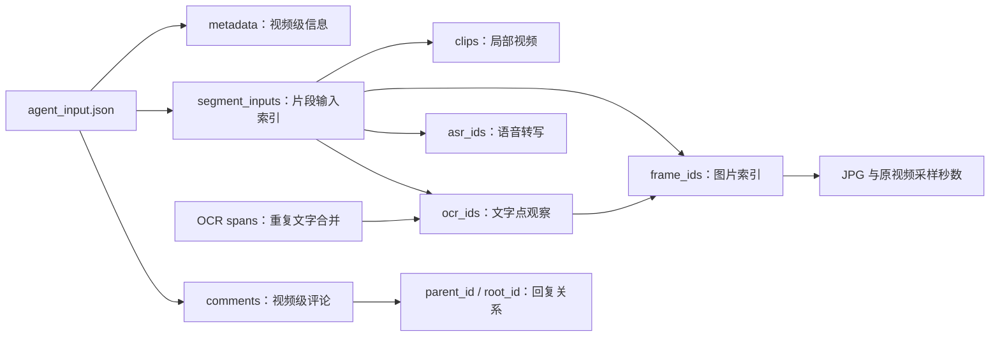

# 当前数据概况与结构说明

整理日期：2026-09-27  
数据位置：`D:\数据汇总\数据汇总\v1` 至 `v10`  
对应项目：`D:\数据汇总\driving_defect_agent`

本文以当前 Agent 使用的 10 个来源数据包为统计对象，依据实际 JSON/JSONL 文件、项目适配器、包内 README、媒体探测记录和本次只读结构校验整理。Agent 在 `runs/` 中生成的分析结果不计入下述输入数据数量。

## 1. 当前数据是什么

当前数据是 **10 个按单个上传视频组织的多模态来源数据包**。每包包含原视频、音轨、预切片段、采样图片、机器语音转写、画面文字识别、平台元数据和部分公开评论，并通过时间戳与 ID 建立对应关系。

这些材料主要来自 B 站上与智能驾驶、辅助驾驶、碰撞或接管相关的视频。内容可能包含发布者讲解、截图、字幕、转述、事故还原和重复慢放。标题中的车型、系统状态、事故原因或责任判断保留为来源说法，不作为已核实标签。

数据已经完成面向程序读取的整理，但仍属于 **机器处理、待人工复核的示例输入**：10 个包的 `split` 均为 `demo_only`，没有正式训练、验证和测试集划分，也没有随包提供缺陷真值、因果真值或参考答案。

## 2. 数据规模

| 项目 | 当前数量或规格 |
|---|---|
| 数据包 / 上传视频 | 10 个 |
| 原视频总时长 | 761.972 秒，约 12 分 42 秒 |
| 单视频时长范围 | 30.700–112.480 秒 |
| 预切视频片段 | 260 个，通常每段 3 秒，末段按实际剩余时长保留 |
| 全画面采样图 | 1417 张 |
| 字幕裁剪图 | 111 张，仅存在于 `v1` |
| 两类采样图合计 | 1528 张；裁剪图不能等同完整道路画面 |
| 默认 ASR | 212 条语音转写 |
| 原始 OCR 检测 | 15820 条，包含重复、噪声与后续排除项 |
| 默认 OCR | 7343 条处理后点观察 |
| OCR spans | 2075 条合并文字观测记录 |
| 公开评论样本 | 427 条：31 条根评论、396 条回复 |
| 提取音频 | 10 个 WAV，16 kHz、单声道、16 bit |
| 数据包目录总文件逻辑大小 | 约 638.45 MiB，含媒体、文本、索引、脚本和说明文件 |

**计数口径：**ASR、默认 OCR、spans 和评论按默认文件的记录统计，片段与图片按索引统计；原始 OCR 按原始文件实际行数统计。OCR 原始检测、默认 OCR 和 spans 是同一批材料的不同处理层，不可相加当成独立证据数量。文件大小不包括 Agent 运行结果，也不包括识别模型权重。

### 2.1 每个包有多少数据

| 包 | 时长（秒） | 片段 | 全画面图 | 裁剪图 | ASR | 默认 OCR | OCR spans | 评论 |
|---|---:|---:|---:|---:|---:|---:|---:|---:|
| v1 | 111.366 | 38 | 112 | 111 | 33 | 172 | 57 | 61 |
| v2 | 98.304 | 33 | 197 | 0 | 9 | 442 | 141 | 92 |
| v3 | 43.607 | 15 | 88 | 0 | 0 | 1005 | 117 | 28 |
| v4 | 79.575 | 27 | 159 | 0 | 35 | 2111 | 370 | 53 |
| v5 | 74.800 | 25 | 150 | 0 | 43 | 330 | 163 | 35 |
| v6 | 42.099 | 15 | 85 | 0 | 3 | 819 | 275 | 58 |
| v7 | 112.480 | 38 | 225 | 0 | 0 | 364 | 223 | 3 |
| v8 | 60.766 | 21 | 122 | 0 | 31 | 947 | 342 | 61 |
| v9 | 30.700 | 11 | 62 | 0 | 11 | 382 | 198 | 31 |
| v10 | 108.275 | 37 | 217 | 0 | 47 | 771 | 189 | 5 |
| **合计** | **761.972** | **260** | **1417** | **111** | **212** | **7343** | **2075** | **427** |

时长展示保留三位小数，合计按未舍入值计算。目录名 `v1`–`v10` 是不同视频包的编号，不是同一个视频的十次版本迭代。

### 2.2 每个包大致是什么素材

下表按标题和包内说明概括主题，不代表已经验证其中的事件、系统表现或责任。

| 包 | 视频 ID | 标题／说明中的主题 | 原视频尺寸 |
|---|---|---|---|
| v1 | BV14spBzFE2V | 辅助驾驶测试与碰撞叙述 | 1920×1080，横屏 |
| v2 | BV1a5Le6REoQ | 脱手驾驶相关事故还原 vlog | 1920×1080，横屏 |
| v3 | BV1aF7B6BEsB | 横杆识别与接管叙述，含帖子截图和慢放／重复画面 | 1920×1080，横屏 |
| v4 | BV1bMNt6uETK | 系统退出与险情转述，混有帖子截图和屏幕回放 | 1080×1920，竖屏 |
| v5 | BV12MEc6hEUa | 脱手驾驶与事故叙述，含解说、剪辑画面与配图 | 1920×1080，横屏 |
| v6 | BV1UCvQBmE6e | 货车相关碰撞及 NCA／AEB 声称，含屏幕回放与车辆照片 | 1920×1080，横屏 |
| v7 | BV1VStJ6UEAD | 高速车速与辅助驾驶关闭困难的叙述 | 720×1280，竖屏 |
| v8 | BV18ydzYrEyk | 事故与责任评论，含出镜评论、报道截图和多组测试素材 | 1080×1920，竖屏 |
| v9 | BV1bkZSY6Ejd | 碰撞素材与其他事件的比较叙述，混有道路画面和屏幕回放 | 1920×1080，横屏 |
| v10 | BV19e5S6PE8X | 与翻倒货车有关的碰撞及“救命”叙述，含局部放大和重复展示 | 1080×1920，竖屏 |

共有 6 个横屏包、4 个竖屏包。现有媒体探测记录显示原视频均为 H.264；帧率存在差异，不能统一按固定 30 fps 换算时间。图片与 OCR 坐标应按对应视频尺寸解释。

一个上传视频可能拼接多个来源，某些画面也可能反复出现。因此 10 个视频包不等于 10 起已确认、相互独立的事故；照片、回放和配图是否属于同一事件需要进一步核实。

## 3. 一个数据包的目录长什么样

```text
vN/
├─ agent_input.json               # 总入口：文件位置、格式、数量和使用约定
├─ metadata.json                  # 标题、简介、发布和采集时间、平台统计快照
├─ README.md                      # 包说明；v1 使用 README_正式输入说明.md
├─ checksums.sha256               # 已有文件完整性校验清单
├─ source/
│  ├─ video.mp4                   # 上传源视频
│  └─ ffprobe.json                # 尺寸、编码、帧率等媒体探测信息
├─ audio/
│  └─ audio_16k_mono.wav          # 供 ASR 与人工复听的音频
├─ clips/                         # 通常每段 3 秒的预切视频
├─ frames/                        # 整秒采样的全画面图片
├─ frames_ocr/                    # v2–v10：半秒时点的全画面图片
├─ ocr_crops/                     # 仅 v1：半秒时点字幕区域拼接裁剪图
├─ indices/                      # 片段、帧和跨模态引用索引
├─ text/
│  ├─ asr.jsonl                   # 默认采用的语音转写
│  ├─ ocr.jsonl                   # 默认采用的 OCR 点观察
│  ├─ ocr_spans.jsonl             # 合并后的文字观测记录
│  ├─ comments.jsonl              # 评论及回复关系
│  └─ ocr_raw.jsonl               # 原始 OCR 检测，供追溯或重新处理
├─ provenance/                   # 处理方法、模型、参数、采集与来源记录
├─ qa/                           # 被排除候选、检查报告和待复核材料
├─ review/                       # 部分包的人工复核说明
└─ scripts/                      # 数据处理与读取脚本
```

这是合并展示的目录示意，不代表每个包拥有完全相同的文件。应先读取 `agent_input.json`，再按其中路径定位文件；不要将整个目录递归拼接为模型上下文。尤其是 `qa/` 中被排除的识别结果，不应重新混入默认输入。

JSON 文件通常保存一个对象；JSONL 文件一行一条 JSON 记录，适合逐条读取和按 ID 检索。媒体通过文件路径引用，不直接嵌入 JSON。

## 4. 各类数据具体包含什么

### 4.1 视频、音频和图片

原视频保留上传素材的画布、黑边、字幕及嵌入画面。短片段主要用于局部读取，部分为缩小分辨率的代理媒体；不能把代理尺寸当成原图尺寸。

采样方式存在版本差异：`v1` 提供约 1 Hz 的全画面图片，并在半秒位置补充字幕裁剪图；`v2`–`v10` 通常每 0.5 秒保存一张完整画面，整秒为 F 帧、半秒为 H 帧。

**数据包已有的采样密度与 Agent 每次实际发送的图片数不同。** 当前 Agent 首轮按 6 秒核心窗口及上下文，从可用全画面帧中按约 1 Hz 选样，不会把包内所有图片一次发给模型。

### 4.2 平台元数据

`metadata.json` 常见字段包括 `video_id`、`title`、`description_raw`、`description_text`、`description_status`、`published_at`、`retrieved_at`、来源 URL 和采集时的播放、评论、点赞等计数。

当前 4 个包有实质简介（v4、v6、v7、v10），5 个为发布者占位符，v3 返回空简介；缺失内容未被补写。平台信息的采集时间主要为 2026-09-24 至 2026-09-25，计数属于当时快照，不是当前实时统计。

### 4.3 ASR：音频里识别到的语句

常见字段为 `utterance_id`、`start_sec`、`end_sec`、`text`、词级时间 `words`、识别方法和质量标记。部分包另有候选 ID、处理窗口或排除标记，不能假设所有包字段完全相同。

默认文件共 212 条，全部 `human_reviewed=false`。这些是语音识别结果，可能存在同音字、漏词、断句和时间偏差。识别分数衡量模型识别置信度，不表示句子所述事实可信的概率。

包内来源记录显示 ASR 使用本地 faster-whisper，语音识别独立于标题和 OCR，没有将字幕或标题补写为音频转写；不同包采用的整段或分窗处理方式有所不同。

`v3` 没有可采用的自动转写；`v7` 的多轮候选出现重复和明显不一致，未进入默认文件。因此两包默认 ASR 为 0，但完整音频仍在，不能解释为已确认全片无语音。

### 4.4 OCR：某个采样时点看到了哪些文字

OCR 点观察通常记录文字 ID、`frame_id`、`timestamp_sec`、`text_raw`、处理后 `text`、`model_score`、四边形坐标 `polygon_xy`、`source_image`、识别批次 `pass` 和来源类型 `source_type`。

默认 OCR 是从原始识别中经过过滤、同时间同位置去重等处理后得到的材料。所有 7343 条默认 OCR 的 `human_reviewed` 均为 `false`。部分记录会保留多个原始检测 ID，以便回查处理依据。

OCR 来源记录使用 RapidOCR；模型、参数、区域放大方式及处理版本应查对应包的 `provenance/ocr_run.json`。

文字可能来自发布者字幕、叠加说明、嵌入帖子、车机屏幕、场景文字或时钟。来源分类通常依据版式和位置规则，不能仅凭 `source_type` 就认定它是已核实的原生车机状态。

OCR 坐标对应各自原图尺寸；经过区域放大识别的坐标也应按记录的坐标约定解释。横屏与竖屏包不能共用一个固定的 1920×1080 坐标系。

### 4.5 OCR spans：把重复观测到的文字合在一起

`ocr_spans.jsonl` 共 2075 条。常见字段包括 `span_id`、`text`、`source_type`、`first_observed_sec`、`last_observed_sec` 和底层 OCR ID 数组。

例如，连续多个采样点出现同一句字幕，可合为一个 span，再回指这些点观察。这样可以减少重复文本，同时保留溯源。首次和末次观察时间表示“采样中看到了”，不是精确的字幕出现／消失时间；只观察到一次时，两者可能相等。

### 4.6 评论：视频级讨论和回复链

评论包含正文、`comment_id`、`parent_id`、`root_id`、发布时间、采集时间、匿名化作者标识 `author_pseudonym`、点赞与回复计数快照、采样方式及父评论上下文状态。

本次检查的 **427 条评论，其 `video_timestamp_sec` 全部为 `null`**。评论发布时间是平台上的发帖时间，不是视频内时间；它们作为视频级背景，不能自动对齐到某次转向或碰撞。

样本来自公开接口可取得的部分评论，既不完整，也不是随机抽样。例如 v2 保存 92 条，而采集时平台计数为 1023；v7 只有 3 条，平台计数为 337。两者口径不同，不能直接将比例当成严格覆盖率或总体意见分布。

5 条评论标记存在图片附件，但附件均未下载；全部评论的 `attachments_downloaded` 为 `false`。数据保留公开评论 ID 和原文引用，作者字段采用匿名标识，因此不应把它描述为已彻底移除所有可识别信息的数据。

## 5. 不同模态如何关联



这里的时间统一指向**当前上传视频从 0 开始的秒数**，片段区间采用 `[start,end)`。片段中的局部秒数换算为原视频秒数时，需要加上该片段的 `start_sec`；不能把每段都当成从全局 0 秒开始。

一个跨片段边界的 ASR 语句可能被多个片段引用，但其 `utterance_id` 不变，仍是一条语句。同一张图可以对应多条 OCR；一个 span 又可以引用多个 OCR 点。它们存在层级与重复关系，不能按文件行数直接累加独立佐证。

若上传素材包含慢放、回放或画面内时钟，这些索引也没有自动恢复真实事件时间。上传视频秒数、画面显示时钟和事故绝对时间是不同概念。

采样目标时点还可能因视频帧率产生细小偏差，例如 v5 的 25 fps 素材可能以 0.48 秒附近的实际帧代表半秒采样目标。应使用记录中的实际时间戳，不强行四舍五入到整秒或半秒。

## 6. v1 与 v2–v10 的格式差异

| 项目 | v1 | v2–v10 |
|---|---|---|
| manifest schema | `1.0.0` | `1.0` |
| 合并片段输入入口 | `indices.segment_inputs` | `indices.segments` |
| 合并表里的媒体路径键 | `video_path` | `path` |
| 全画面帧索引 | `indices/frames.jsonl` | `indices/all_frames.jsonl` |
| 半秒位置图片 | `indices/ocr_half_frames.jsonl` 指向字幕裁剪图 | H 帧与 F 帧一起列入全画面索引 |
| 片段帧引用 | `frame_ids` | `frame_ids`，另有包含 F/H 的 `all_frame_ids` |
| 默认 OCR 的公共 ID | `text_id`，通常以 O 开头 | `ocr_id`，通常以 O 开头 |
| 原始 OCR 引用 | `ocr_id`、`duplicate_raw_ids` | `raw_record_ids` |
| span 的底层引用字段 | `observation_ids` | `ocr_ids` |
| span 入口位置 | `text.ocr_grouped` | `optional_source_data.ocr_spans` |

特别注意：v1 的 `ocr_id` 可能是以 R 开头的原始识别 ID，而片段默认引用的是 O 开头的 `text_id`。读取时直接统一抓取同名字段会产生错误关联。当前项目通过 V1/V2 适配器转换为统一结构。

同属 schema `1.0` 的包也有可选字段差异。例如 `candidate_id` 出现在部分 ASR 记录中，关联时仍应以 `utterance_id` 为准。

## 7. 一组最小结构示例

以下按 v2 风格展示部分字段；ID、正文和数值均为**示意占位值，不是原始记录摘录**。

```json
{
  "segment_id": "S000",
  "start_sec": 0,
  "end_sec": 3,
  "path": "clips/S000.mp4",
  "frame_ids": ["F0000", "F0001", "F0002"],
  "all_frame_ids": ["F0000", "H0000", "F0001", "H0001", "F0002", "H0002"],
  "asr_ids": ["A000"],
  "ocr_ids": ["O00000"]
}
```

```json
{
  "utterance_id": "A000",
  "start_sec": 0.2,
  "end_sec": 2.8,
  "text": "语音转写示例",
  "human_reviewed": false
}
```

```json
{
  "ocr_id": "O00000",
  "frame_id": "H0000",
  "timestamp_sec": 0.5,
  "text": "画面文字示例",
  "source_image": "frames_ocr/half_0000.jpg",
  "raw_record_ids": ["R00001"],
  "human_reviewed": false
}
```

```json
{
  "comment_id": "COMMENT_REPLY_EXAMPLE",
  "parent_id": "COMMENT_ROOT_EXAMPLE",
  "root_id": "COMMENT_ROOT_EXAMPLE",
  "text": "评论正文示例",
  "video_timestamp_sec": null
}
```

## 8. 质量状态、缺失与当前检查结果

本次使用项目的 `load_package` 与 `validate_package` 只读加载并检查了全部 10 个包：均可加载，记录数量与入口清单一致，**没有 error，出现 11 条 warning 和 5 条 info**。

| 项目 | 实际情况 | 对使用的影响 |
|---|---|---|
| 父评论缺失 | 共 11 条回复缺直接父评论：v1 1 条、v5 1 条、v6 4 条、v8 4 条、v9 1 条 | 回复上下文可能不完整；保留原父 ID，不补造内容 |
| 默认 ASR 为空 | v3、v7，共 2 条信息提示 | 有音轨，不代表没有语音；可转人工复听 |
| 极短尾片段 | v1 0.366 秒、v6 0.099 秒、v10 约 0.275 秒，共 3 条信息提示 | 正常保留，不应作为无效片段直接丢弃 |
| 人工复核状态 | 212 条 ASR、7343 条默认 OCR 均为 `human_reviewed=false` | 可用于候选线索分析，不能直接当人工金标准 |
| OCR 覆盖 | 按采样时点识别，另有区域放大识别 | 瞬时文字、小字、遮挡和模糊内容可能遗漏 |
| 平台字幕 | 元数据中的可用字幕轨列表均为空 | 表示本次公开响应未取得字幕轨，不证明平台绝无字幕 |
| 弹幕与评论附件 | 未采集弹幕，未下载评论图片 | 这些模态不能算作已提供证据 |
| 车型／软件版本字段 | 元数据中的 `model`、`software_version` 均为 null | 标题或 OCR 中的型号、版本说法需要另行核实 |
| 数据划分与标签 | 全部 `demo_only`，无随包缺陷／因果真值 | 当前可用于流程研究，不能直接声称具备监督评测真值 |

上述检查主要验证计数、ID 引用、路径与时间等结构条件，没有重新完整解码全部媒体或逐文件复算 SHA-256。包内保留既有验证报告和 `checksums.sha256`，可供进一步检查；结构合格与内容真实是两个不同问题。

文件名中的“人工复核清单”表示待检查事项，不代表已经完成听音、看图或事实验收。

## 9. 这些输入与 Agent 生成数据的区别

| 层次 | 位置 | 内容性质 |
|---|---|---|
| 原始媒体与平台材料 | `数据汇总/vN/source`、`audio`、`metadata.json`、评论记录 | 已收集的来源材料 |
| 数据准备产物 | `clips`、帧图、ASR、OCR、spans、索引 | 便于读取的派生输入，仍带识别和采样限制 |
| 复核与溯源材料 | `qa`、`review`、`provenance` | 处理依据、排除原因、人工复核任务 |
| Agent 分析结果 | `driving_defect_agent/runs/<run_id>/videos/<video_id>/` | 运行后生成的陈述、观察、事件、候选归因和报告 |

Agent 生成的 `claims.jsonl`、`observations.jsonl`、`events.jsonl`、`hypotheses.jsonl` 和 `report.md` 属于分析结果，不是原始输入标签。它们可以回查证据，但不能作为独立于输入的额外事实来源。

对当前研究而言，这套数据适合验证多模态读取、时间关联、证据检索、线索提取和人工复核流程。若要评价真实识别准确率或开展监督训练，需要另外完成有效人工标注与复核，并按原始来源或事件分组划分数据，避免转载、回放和同源素材造成泄漏。

## 10. 建议的阅读顺序

1. 先看本说明中的规模表和特殊包说明，了解模态是否齐全。
2. 进入目标 `vN`，读取 `agent_input.json` 与 README，确认该包实际路径和 schema。
3. 按片段索引找到相应图片、ASR 和 OCR，再用底层 ID 回查来源。
4. 有疑问时查看原视频、音轨、`provenance` 和对应复核材料。
5. 阅读 Agent 结果时，可同时参照同目录的《当前 Agent 详细工作流程》，区分来源数据、模型判断和规则判定。

主要依据：10 个包的 `agent_input.json`、`metadata.json`、默认文本与索引文件、README、`source/ffprobe.json`，以及项目 `src/defect_agent/adapters/` 和 `validation.py` 的只读加载与校验结果。
